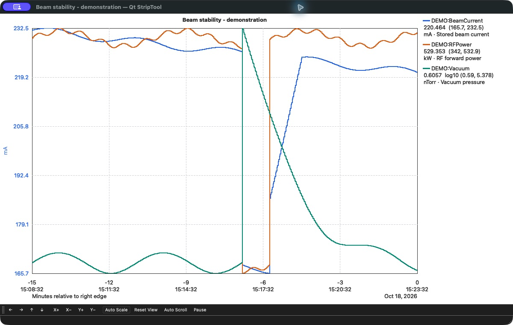
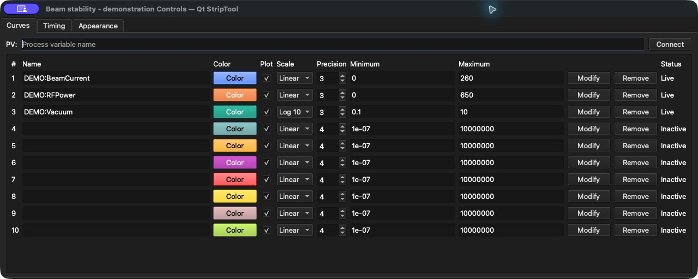
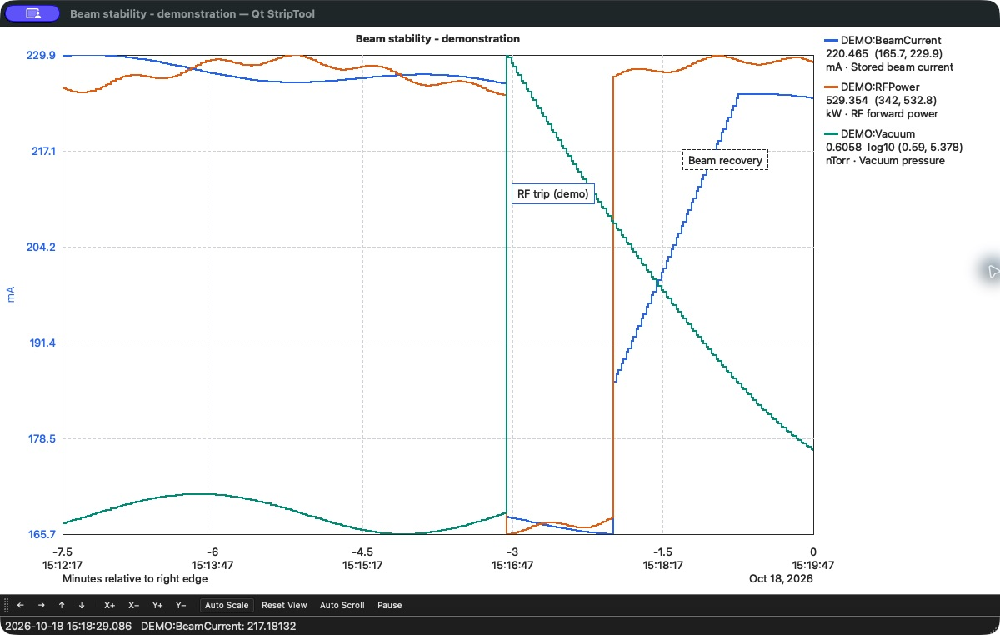

# StripTool

This repository builds two EPICS trend applications side by side:

- `StripTool` is the maintained legacy Motif application in `striptool/`.
- `qtstriptool` is the C++17/Qt replacement in `qtstriptool/`.

Qt StripTool 1.0.0 is the first normal release. It supports live Channel Access,
ten-curve controls, compatible configuration load/save, graph interaction,
annotations, Archiver Appliance history, text/CSV, optional SDDS and image export, and Qt
printing. It remains a separately named application so sites can keep the
legacy StripTool available where a documented difference matters.

## Qt StripTool highlights

The screenshots below show the running Qt application on macOS with isolated
demonstration PVs and synthetic archive data.

### Live trends and archive history

Compare timestamped Channel Access values with Archiver Appliance history in
one graph. Color-coded traces, units, latest values, and plotted ranges keep
curves identifiable; auto-scroll, pan, zoom, and auto-scale help explore the data.
This example shows beam current, RF power, and vacuum pressure through a
simulated RF trip and recovery.



### Ten curves, individual settings

Configure up to ten PVs in one window, with a color, plot toggle, linear or
logarithmic scale, precision, and limits for each curve. Connection status is
visible alongside the settings. The Timing and Appearance tabs control history
length, sample capacity, refresh rate, graph colors, and grid styling.



### Investigate events and share results

Zoom into a time range and add movable, editable annotations to mark events
and explain changes. Export the visible data as CSV, text, or SDDS (when available), save a graph
snapshot, or use print preview and Qt printing to share the result.



See the [Qt user guide](docs/qtstriptool-user-guide.md) for these workflows and
the [screenshot capture notes](docs/screenshots/qtstriptool/README.md) for the
demo setup.

## Repository layout

- `striptool/` — Motif implementation; executable name `StripTool`.
- `qtstriptool/` — Qt implementation; executable name `qtstriptool`.
- `docs/legacy/` — historical manuals and release notes.
- `docs/` — compatibility baseline, parity matrix, and Qt documentation.
- `tests/fixtures/` — toolkit-independent `.stp` compatibility fixtures.

## Dependencies

Both applications require a built EPICS Base with Channel Access headers and
libraries. Set `EPICS_BASE=/path/to/base` if it is not found in a common
sibling or APS location. The build uses the host architecture reported by
EPICS Base.

Qt StripTool additionally requires a C++17 compiler and either Qt 5.15 or Qt 6
development files for Core, Gui, Widgets, Network, and PrintSupport, plus the
matching `moc` and `rcc` tools. Qt Test is also required to run the tests, and
the Windows build requires it to build at all. Unix builds normally discover
Qt with `pkg-config`; Qt 6 may also be discovered with `qmake6`. Select a major
version explicitly with `QT_VERSION=5` or `QT_VERSION=6`.

SDDS export is enabled automatically when compatible SDDS headers and libraries
can be linked. The build tries the sibling `SDDS` checkout (`include` and
`lib/<OS>-<ARCH>`), configured EPICS extensions directories, and
`/usr/local/epics/extensions`. Set `SDDS_REPO=/path/to/SDDS` to select another
checkout, or set both `SDDS_INCLUDE_DIR` and `SDDS_LIB_DIR` to select an installed
copy. These explicit directory overrides disable fallback searching; pointing
them to nonexistent directories builds without SDDS. Core SDDS headers and
libraries always come from the same installation. Missing or unusable SDDS
dependencies silently omit the SDDS export action; text and CSV remain available.
Discovery compiles a link probe without executing it, with diagnostic logs under
`qtstriptool/O.<OS>-<ARCH>-qt<version>/sdds-probe-*.log`.

On Linux, the build prefers `/usr/bin/pkg-config` so an active Conda
environment does not select Conda's Qt through its `pkg-config` wrapper.
This also applies inside `rhel8-shell`, where `/usr` refers to the container.
To select another installation, set `PKG_CONFIG` and, if needed,
`PKG_CONFIG_PATH` explicitly, for example `make -j4 PKG_CONFIG=/path/to/pkg-config`.
Run `make clean` before switching between host and container builds or Qt
installations, then rebuild in the selected shell.

Legacy StripTool additionally requires Motif and X11 development files,
including Xm, X11, Xmu, and Xpm. It is not built on Windows. Typical Linux
package names include `qtbase5-dev` (or the distribution's Qt 6 base
development package), `libmotif-dev`, `libx11-dev`, `libxmu-dev`, and
`libxpm-dev`; names vary by distribution. On macOS, install Qt and the EPICS
dependencies with the site's selected package manager and provide Motif/XQuartz
only if the legacy application is required. The Windows path expects Qt 6 for
MSVC, a compatible EPICS Base build, GNU Make, and the MSVC command-line tools;
set `QT_DIR`, `EPICS_BASE`, and `EPICS_HOST_ARCH` as needed.

## Build and test

Run from the repository root:

```sh
make                              # Build every available variant
make striptool                    # Build legacy Motif StripTool
make qtstriptool                  # Build Qt StripTool
make test-qtstriptool             # Core, config, UI, performance, and memory tests
make test-qtstriptool-core
make test-qtstriptool-config
make test-qtstriptool-ui
make test-qtstriptool-performance
xvfb-run -a -s '-screen 0 1920x1080x24' make -C qtstriptool test-qtedm-drop # Real QtEDM PV drops
xvfb-run -a make -C qtstriptool test-motif # MEDM drop protocol (Linux; Motif/XTest dev files)
make test-qtstriptool-visual
make test-qtstriptool-ioc             # Self-contained IOC restart/reconnect test
make test-qtstriptool-ioc TEST_PV=some:readable:numeric:pv  # Also test a site PV
make test-qt-versions             # Test each locally available Qt major
make clean
make distclean
```

The Qt tests keep Channel Access on the local host whatever `EPICS_CA_*`
says, and send no archive requests to the operational Archiver unless
`QTSTRIPTOOL_ARCHIVER_URL` points there. Only the `TEST_PV` step of the IOC
test uses the site Channel Access configuration.

If Motif is unavailable, the default build reports that the legacy variant is
being skipped. A missing Qt or EPICS Base is an error for the Qt build. Build
products are placed in `bin/<OS>-<architecture>/`; Qt object trees are named
`qtstriptool/O.<OS>-<architecture>-qt<major>`.

On APS Linux hosts, the build automatically uses the RHEL 8-built GCC suite at
`/usr/local/oag/3rdParty/gcc-11.3.0` when its `gcc` and `g++` executables are
available. This matches the compiler used for the site EPICS libraries and
statically links the C++ runtime, following the MEDM build convention. Set
`CUSTOM_GCC_PATH=/another/gcc/prefix` to select another installation, or set it
to an empty value to use the compiler from `PATH`. Run `make distclean` before
switching compilers so objects from different C++ ABIs are not mixed. Use this
compiler from `rhel8-build shell` when producing a RHEL 8-compatible binary;
the compiler path by itself does not prevent a build run on RHEL 9 from taking
dependencies on RHEL 9 glibc symbols.

When checked out as `<extensions>/src/StripTool` in an EPICS extensions tree,
the normal builds also copy executables into the extensions host binary
directory. This is separate from the staged system packaging described below.

## Run

```sh
bin/$(uname -s)-$(uname -m)/StripTool example.stp
bin/$(uname -s)-$(uname -m)/qtstriptool example.stp
bin/$(uname -s)-$(uname -m)/qtstriptool -history=3600 -sampleCount=7200 example.stp
bin/$(uname -s)-$(uname -m)/qtstriptool -style adwaita example.stp
```

Qt StripTool defaults to the Fusion style for consistent, compact controls
across desktop environments. Qt consumes standard Qt options such as `-style`,
which can select another installed style; application-specific syntax
is `qtstriptool [--help] [--version] [-history=seconds] [-sampleCount=count] [configuration.stp]`.
The timing options override the loaded configuration. `-history` sets the
initial time window and automatic archive backfill; `-sampleCount` sets the
maximum live samples per curve. A bare configuration
name is searched in the current directory and then `STRIP_FILE_SEARCH_PATH`.
With no configuration argument, or if the given file cannot be loaded,
`qtstriptool` loads `StripTool.stp` from the current directory if it exists,
and **File > Save** then writes back to it; otherwise it starts with compiled
defaults.

## Install and package Qt StripTool

On Unix-like systems, stage or install the Qt application and its desktop
metadata with:

```sh
make install-qt-package PREFIX=/usr/local
make install-qt-package DESTDIR=/tmp/qtstriptool-stage PREFIX=/usr
make package-qtstriptool
```

The install target writes under `PREFIX`: `bin/qtstriptool`, the desktop entry,
the scalable icon, AppStream metadata, the license, author credits, and these guides. `DESTDIR` supports
distribution staging. The package target creates a relocatable staging tarball
under `O.package/`; it is not a native RPM, DEB, or signed application bundle
and does not bundle Qt runtime libraries.

For Windows, build the executable, copy it into an application directory, run
Qt's `windeployqt` on it, and include compatible EPICS `ca.dll` and `Com.dll`
plus their required runtimes. Test that directory on a clean host before
distribution. A macOS release should similarly use the selected Qt deployment
tool and the site's signing/notarization process; these bundles are not yet
release-verified.

Do not install a `StripTool` symlink to `qtstriptool` yet. See the user guide
for launch-script and desktop-entry migration with an explicit rollback path.

## Documentation

The [HTML documentation site](docs/site/index.md) provides searchable operator
guides and reference in the same style as QtEDM and QtALH. With Node.js 22+
and Python 3, build and serve it locally:

~~~sh
make docs
python3 -m http.server 8000 --directory docs/html --bind 127.0.0.1
~~~

For hosting below a URL prefix, use
~~~sh
make docs DOCS_BASE=/manuals/QtStripTool/
~~~
See the [documentation workflow](docs/site/develop/documentation.md).

- [Qt user guide](docs/qtstriptool-user-guide.md)
- [Authors and acknowledgments](docs/site/project/authors.md)
- [Compatibility, known differences, and rollout](docs/qtstriptool-compatibility.md)
- [Appearance and visual review](docs/qtstriptool-appearance.md)
- [Performance and soak testing](docs/qtstriptool-performance.md)
- [Parity matrix](docs/QtParityMatrix.md)
- [Legacy compatibility baseline](docs/StripToolCompatibilityBaseline.md)
