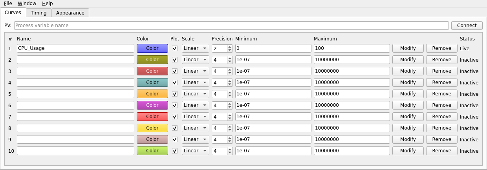
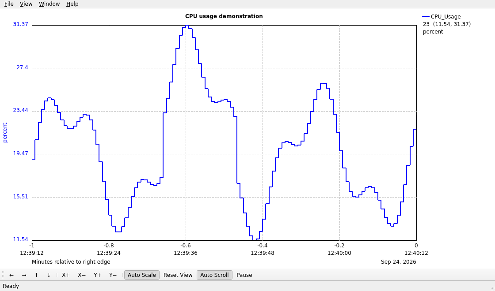

# Plot your first PV

You need a built `qtstriptool` and a reachable EPICS Channel Access process variable. Check your site's `EPICS_CA_ADDR_LIST` and `EPICS_CA_AUTO_ADDR_LIST` settings if the PV cannot connect.

## Open the graph and Controls

Run `qtstriptool` without a configuration file. The graph and Controls windows open together. If the current directory contains `StripTool.stp`, Qt StripTool loads it and its curves connect, and **File > Save** later writes back to that file; run it from a directory without that file to start from compiled defaults. Later, use **Window > Show Controls** in the graph to reopen Controls. **File > Dismiss** in Controls hides it while the graph is open. If you dismissed the graph, Controls is the only remaining window, so **File > Dismiss** asks whether to exit instead; choose **No** to keep working. **Window > Show Graph** in Controls shows the graph again and brings it to the front.

<figure class="doc-shot">
  
  <figcaption>The Curves tab with the built-in CPU_Usage channel connected. Enter your site PV in the field at the top.</figcaption>
</figure>

## Connect a curve

1. Enter a PV name in the **PV** field and select **Connect**, or enter the name in an unused curve row.
2. Keep **Plot** enabled. Select **Modify** to apply other row edits, or press Return in that row's Name, Minimum, or Maximum field.
3. Watch the graph and the Controls row. The graph shows Channel Access monitor updates as they arrive; the Controls row shows connection and stale status.

If the PV is quiet, its last value can remain visible as a step line. A **Stale** status does not by itself remove the plotted value. An actual disconnect creates a gap.

## Explore and save

**View > Auto Scale** is on by default, so the value axis already fits the visible data. Zooming or panning the value axis turns it off; choose **View > Auto Scale** again to resume fitting. Choosing it while it is checked, or choosing **View > Reset View**, turns it off and returns to configured curve limits. The time axis shows relative offsets above local clock time, choosing seconds, minutes, hours, or days for the visible duration. The rightmost relative label is zero.

<figure class="doc-shot">
  
  <figcaption>An example graph session with illustrative CPU_Usage values. The toolbar along the bottom provides pan, zoom, auto-scale, reset, auto-scroll, and pause.</figcaption>
</figure>

Choose **File > Save As** to write a `.stp` configuration. Open it later with `qtstriptool configuration.stp` or **File > Open**. The file holds supported configuration settings; runtime annotations and sampled data are not saved in it.

## Get help

Press F1 or choose **Help > Help Topics** in either window to open the user guide built into the application. It works without a network connection, lists topics in a sidebar, and can search the whole guide. **Help > Keyboard Shortcuts** lists the keyboard and mouse controls, and **Help > Online Manual** opens this website, or the location set in [`STRIP_HELP_PATH`](../reference/environment).

Continue with [curve controls](../operate/curves), [graph navigation](../operate/graph), or [troubleshooting](../operate/troubleshooting).
