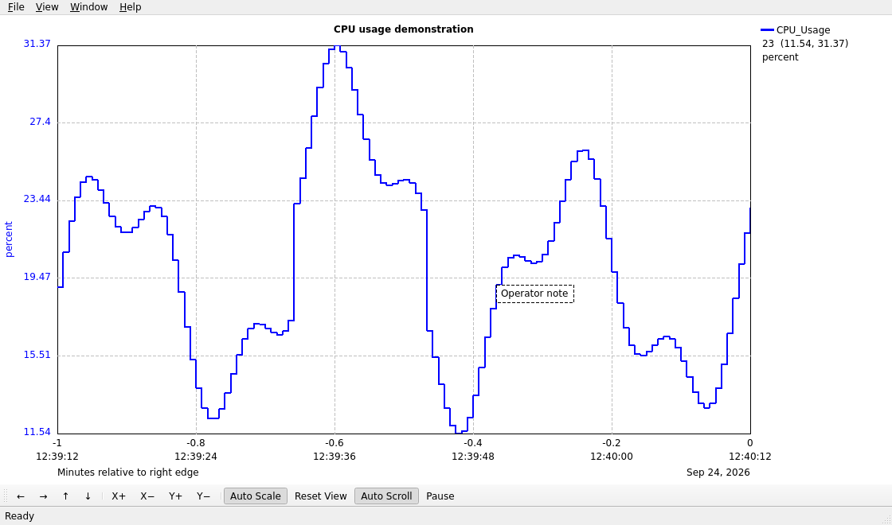

# Read and navigate the graph

The graph plots timestamped monitor values as step lines. A vertical axis can be colored for its curve; the legend beside the plot shows visible curve names and latest values.

## Read time and values

Each X-axis tick has a relative offset above local clock time. Offsets use seconds for windows shorter than a minute, minutes below an hour, hours below a day, and days for longer windows. At an hour or more, clock labels omit seconds; at a day or more they include the month and day. The rightmost relative label is zero; earlier ticks are negative. With auto-scroll enabled, the right edge follows the latest time. With auto-scroll off, it marks the end of the fixed visible range.

Y-axis ticks use four significant digits, adding digits only when needed to distinguish ticks in a narrow range. Legend rows, axis margins, and label spacing follow the desktop font size. The legend always shows each curve's latest value and plotted limits in full, widening as needed but never shrinking while the curve is unchanged, so the plot does not shift as values update. The latest value is rounded to six significant digits, as in the legacy legend; a curve **Precision** above 6 keeps more digits, up to 15. Long PV names, units, and comments are elided when space is limited; hover over the entry for the full text.

Move the pointer over the plot to update the location readout. Click a legend entry to read that curve's value at the pointer location.

## Navigate

The **View** menu can pause time scrolling, toggle auto-scroll, pan in time or value, zoom either axis, toggle auto-scale, reset, clear data, and force a replot. The toolbar has arrows for panning, `X+`/`X−` for time zoom, and `Y+`/`Y−` for value zoom. Right click a toolbar Pan or Zoom button for a smaller step. Drag empty plot space with the left button to pan.

Vertical zoom uses logarithmic units for Log 10 curves. **Auto Scale** is on by default and keeps the value axis fitted to visible data. Zooming or panning the value axis turns it off, starting from the fitted range; select **Auto Scale** again to resume fitting. Unchecking **Auto Scale** restores configured limits. **Reset View** also turns it off, restoring configured limits and the time view.

Enabling **Auto Scroll** preserves the current visible duration and moves its right edge to now. Toolbar time zoom keeps auto-scroll enabled and anchors the right edge. Mouse-wheel zoom fixes the timestamp under the pointer and disables auto-scroll. **Pause** holds the view; resuming preserves its duration. **Reset View** restores the configured History length.

## Annotate an event

Right click the graph and choose **Annotate Here** to add a note at that time and value. Double click an annotation to edit it, or double click empty plot space to add one. Left click a box to select it; hold the middle button to move it. Delete or Backspace removes the selected annotation.

<figure class="doc-shot">
  
  <figcaption>An operator note on an illustrative trace. The dashed outline shows the selected annotation.</figcaption>
</figure>

Annotations are runtime graph state and are not saved in `.stp` files. Use [snapshot export](./files) if you need an image of the annotated plot.
