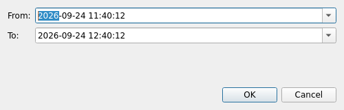

# Historical data

Choose **View > Historical Range** to request a time range from an EPICS Archiver Appliance. The dialog starts with the graph's current visible range. The From time must be earlier than the To time; otherwise an **Invalid Range** warning appears, nothing is requested, and pending requests continue. The From and To fields accept times from 1970-01-01 to 2100-01-01 UTC. When you select **OK** with a valid range, the graph moves to the chosen range, auto-scroll turns off, and the archived samples join the live data as they arrive. Requests run in the background, and a new Historical Range request replaces any that are still pending.

<figure class="doc-shot doc-shot--compact">
  
  <figcaption>Choose the start and end time before requesting archived samples.</figcaption>
</figure>

The default retrieval root is `http://asddtn03.aps4.anl.gov:17668/retrieval`. Set `QTSTRIPTOOL_ARCHIVER_URL` before launch to use another retrieval root or a `data/getData.json` endpoint. Requests use the Archiver's `lastSample` reduction, with bins of at least one second sized so that each PV returns at most about 10,000 points. Numeric archived samples retain archive timestamps, status, and severity; archived strings and waveforms are ignored.

When a Channel Access PV is added, Qt StripTool also attempts a background request for the configured **History length** in the Timing tab. The default is five minutes. Set a different startup window with `qtstriptool -history=3600 -sampleCount=7200`, or set it in a configuration file. The sample count bounds the live buffer independently of archived samples. If that backfill is unavailable, live plotting continues. Zooming out or panning earlier than the retrieved history automatically requests the newly exposed span once the view settles, and joins it to the plotted data. These extension requests are also silent. A span that failed is not requested automatically again, even after the PV reconnects, until the curve is removed and added again or the configuration is reloaded with **File > Open** or **Open Recent**; changing a curve's PV name requests history for the new PV instead. To retry sooner, use **View > Historical Range**; an explicit Historical Range request reports errors instead. Once live updates exceed the sample count, the oldest live samples are discarded and the graph leaves a gap between the archived data and the oldest retained live sample rather than holding the last archived value across it. That span is not requested automatically; use **View > Historical Range** to retrieve it. The live buffer keeps discarding its oldest samples after such a retrieval, and discarded samples newer than the retrieved range are not marked with a gap again, so the last retrieved archived value can again be held across them until you repeat the Historical Range request for that span. The local `CPU_Usage` curve is live only and is not sent to the Archiver.

Each automatic request uses the `lastSample` bin size for the span it covers when it is sent. A History length above 10,000 seconds (about 2.8 hours), or a zoom-out or pan that exposes more than 10,000 seconds at once, therefore retrieves bins longer than one second. Zooming in later does not request that history again at a finer interval, so a close-up or export of it shows at most one sample per bin and can miss short spikes. To refine the current view, choose **View > Historical Range** and select **OK**: the dialog starts with the visible range, which is retrieved at the bin size for its own span (one second for any range up to 10,000 seconds) and joined with the data already plotted. The **Archive history reduced** notice in the status bar appears only when Qt StripTool reduces a curve's archived samples to its own per-curve limit (65,536 samples or 2 MiB, whichever is smaller); it does not report the Archiver's `lastSample` bins.

See [environment variables](../reference/environment) for the override and [compatibility](../understand/compatibility) for provider differences from Motif StripTool.
